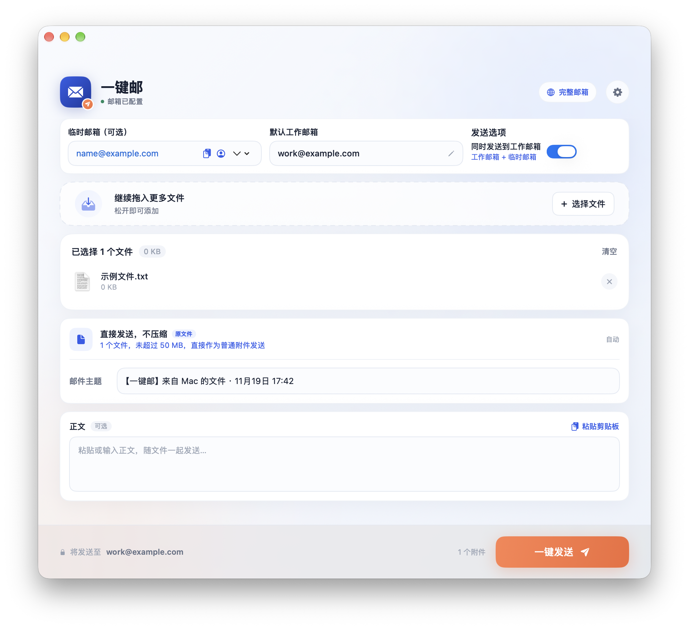
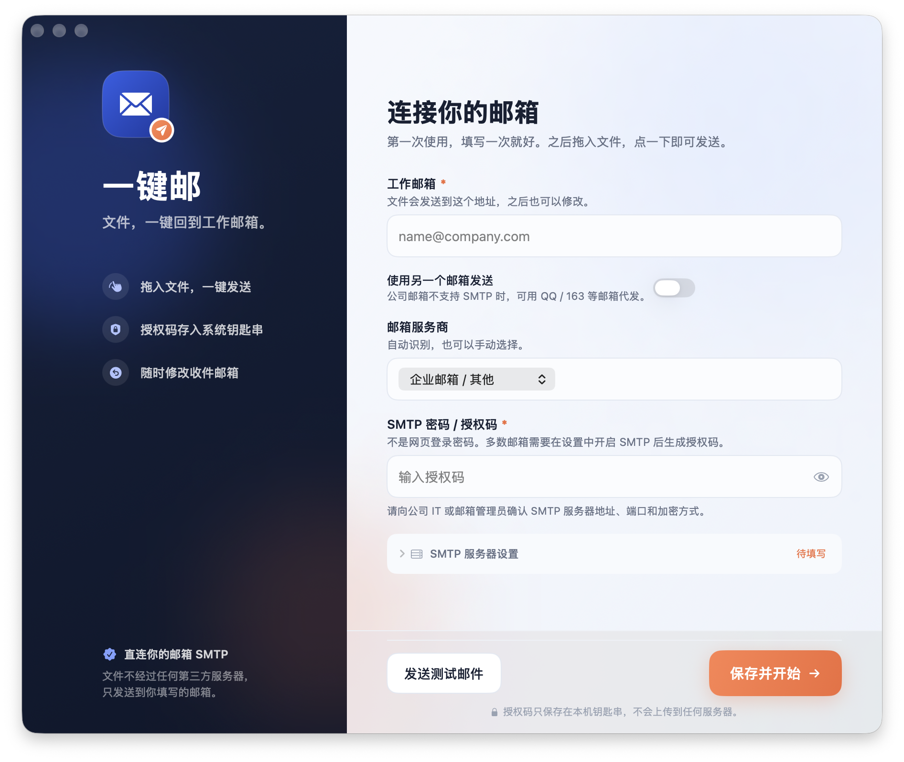

# 一键邮

一个原生 macOS 小工具：把文件拖进来，点一下，就发到你的工作邮箱。



不依赖系统「邮件」App，也不需要每次登录网页邮箱。应用通过你自己邮箱的 SMTP 服务直接发送，文件不经过任何第三方服务器。

## 功能

- 拖入任意格式的文件，支持一次发送多个
- 所有邮件主题自动加 **【一键邮】**，方便后续筛选和清理
- **1 个文件且小于 50 MB：不压缩，直接作为普通附件发送**
- **2 个及以上文件，或文件达到/超过 50 MB：自动压缩**
- 文件总量超过单封限制时，自动打包成 **多个 ZIP**；压缩后总量不超限就合并到一封邮件，超限才分多封
- 邮件发送成功后，会弹出 macOS 通知
- 一键发送到固定工作邮箱，快捷键 `⌘↩`
- 首次打开引导填写工作邮箱、发件邮箱和授权码
- 主窗口任意位置（包括顶部、边距和底部栏）都可拖入文件
- 主窗口可自由缩放（最小 820×640），内容随窗口自适应
- 主界面左侧可输入/粘贴临时邮箱，右侧可选择是否同步发送到默认工作邮箱
- 关闭同步时只发送到临时邮箱，不发送到工作邮箱
- 随时点右上角收件人输入框或齿轮修改邮箱地址
- 授权码存入 macOS 系统钥匙串，不写入配置文件
- 显示附件总大小和单封上限；QQ 为 50 MB，其他服务商保守按 20 MB
- 可发送测试邮件，确认配置是否可用
- 设置页支持「仅验证登录」：不发送邮件，直接显示 SMTP 服务器返回的拒绝原因
- 自动去除授权码首尾空格；QQ 授权码会提示是否为 16 位
- 针对 QQ 邮箱的登录兼容处理：`curl` 被判登录失败时，自动改用系统 OpenSSL 以 QQ 接受的方式重试发信
- 把文件拖到 Dock 里的应用图标上，也会自动加入发送列表
- 可添加到 Finder 右键菜单：选中文件后直接「用一键邮发送」

## 安装

已经安装到：

```text
~/Applications/一键邮.app
```

也可以从源码重新构建并安装：

```bash
cd macos
./scripts/build.sh
./scripts/install.sh
```

系统要求：macOS 14 或更高版本；从源码构建需要 Xcode 命令行工具。

## 第一次使用



1. 打开「一键邮」。
2. 填写你的**工作邮箱**（文件会发送到这里）。
3. 选择**邮箱服务商**；应用会根据发件邮箱自动识别。
4. 填写**SMTP 授权码**（不是网页登录密码）。
5. 点「保存并开始」。

### 公司邮箱不支持 SMTP 怎么办？

打开「使用另一个邮箱发送」，把发件邮箱改成 QQ / 163 等支持 SMTP 的邮箱，工作邮箱仍然填公司的地址。这样是用你的个人邮箱代发到工作邮箱。

### 各邮箱的授权码

| 邮箱 | SMTP 服务器 | 端口 | 加密 | 密码填什么 |
| --- | --- | --- | --- | --- |
| QQ 邮箱 | smtp.qq.com | 465 | SSL | QQ 邮箱授权码 |
| 163 邮箱 | smtp.163.com | 465 | SSL | 163 邮箱授权码 |
| 126 邮箱 | smtp.126.com | 465 | SSL | 126 邮箱授权码 |
| Gmail | smtp.gmail.com | 465 | SSL | Google 应用专用密码 |
| Outlook | smtp-mail.outlook.com | 587 | STARTTLS | Microsoft 应用密码 |
| iCloud | smtp.mail.me.com | 587 | STARTTLS | App 专用密码 |
| 企业邮箱 | 询问公司 IT | 常见 465 / 587 | SSL / STARTTLS | SMTP 密码或授权码 |

QQ 邮箱的授权码：登录 QQ 邮箱 → 右上角设置 → 左下角账号与安全 → 安全设置 → POP3/IMAP/SMTP/Exchange/CardDAV 服务 → 生成授权码。163 / 126 在「设置 → POP3/SMTP/IMAP」中开启。

## 日常使用

1. 在右上角「收件邮箱」直接输入或点剪贴板图标粘贴其他邮箱；默认值来自设置，可随时改。
2. 把文件拖进窗口，或点「选择文件」。
3. 可点「粘贴剪贴板」把剪贴板文字填入正文；正文为空时自动使用附件说明。
4. 应用会自动判断压缩方式：
   - 1 个文件且小于 50 MB：直接作为普通附件发送；
   - 2 个及以上文件，或单个文件达到/超过 50 MB：自动压缩。
5. 文件总量超过单封限制时，应用会自动打包成多个 ZIP。**只要压缩后总大小不超过单封上限，多个 ZIP 会一起放在同一封邮件里**；只有总量仍超限时才分多封。
6. 需要时修改邮件主题；发送时主题会自动带上【一键邮】。
7. 点「一键发送」，或按 `⌘↩`。发送成功后会收到 macOS 通知；第一次成功发送时系统会询问通知权限，选择「允许」即可。

需要分多封时，主题会带（第 1/3 封）这样的序号；压缩包文件名也会带 `_1of3`，方便按顺序保存。如果一封邮件里放了多个压缩包，主题不会加“第几封”。

发送成功后，文件会出现在工作邮箱里。应用不会自动删除已选文件，方便再次发送；点文件右侧的 `×` 或「清空」可以移除。

## 在 Finder 右键直接发送

第一次打开新版应用时，会询问是否把「用一键邮发送」加到右键菜单。

选择「添加到右键菜单」后：

1. 在 Finder 中选中一个或多个文件；
2. 右键 → 快速操作（或服务）→ **用一键邮发送**；
3. 应用会直接使用已保存的邮箱和授权码发送，不需要先打开应用。

如果当时点了「暂不添加」，可以到「邮箱设置 → Finder 右键菜单」里点「刷新菜单」。

如果右键菜单里暂时看不到，打开一次「系统设置 → 键盘 → 键盘快捷键 → 服务」，确认「用一键邮发送」已勾选；或重启 Finder。

## 修改邮箱

点主界面右上角的收件人胶囊，或齿轮按钮，打开「邮箱设置」：

- 修改**工作邮箱**（收件地址）
- 修改**发件邮箱**和显示名称
- 更换服务商、SMTP 服务器、端口、加密方式
- 输入新授权码（留空则继续使用已保存的授权码）
- 点「发送测试邮件」验证配置

设置窗口底部的按钮始终可见，表单内容较多时可在中间区域滚动。

## 安全说明

- 邮件通过你的邮箱服务商 SMTP 直接发出，不经过本工具作者的服务器。
- SMTP 授权码只保存在 macOS 登录钥匙串，服务名为 `com.beibei.oneclickmail.smtp`。
- `UserDefaults` 里只保存收件邮箱、发件邮箱、服务器地址等非敏感配置。
- 授权码只通过标准输入交给系统发送组件，不会出现在命令行参数或日志里。
- 临时邮件文件和临时 ZIP 压缩包写入系统临时目录，压缩包权限 `0600`，发送结束后立即删除。
- ZIP 由应用原生生成，支持中文文件名，不依赖外部压缩工具。
- 应用没有沙盒网络权限之外的额外权限，也不读取通讯录、浏览器或邮件内容。

### 钥匙串提示

应用使用本地临时签名。如果重新构建过应用，第一次读取之前保存的授权码时，macOS 可能会弹出：

> “一键邮”想要使用你储存在钥匙串中的机密信息

如果弹窗要求输入密码，请输入你的 **Mac 登录密码**，再点「始终允许」。之后这个版本不会再询问。如果点了「拒绝」，在设置里重新输入一次授权码也能恢复。

## 常见问题

**提示「邮箱登录失败」**

说明 SMTP 登录被拒绝。请确认：

- 填的是授权码，不是网页登录密码；
- 已在邮箱设置中开启 SMTP 服务；
- 发件邮箱和授权码属于同一个账号；
- QQ 授权码通常是 **16 位小写字母**；输入框下方会显示当前位数；
- 短时间连续失败可能触发 QQ 的登录频率限制，等 10–15 分钟再试。

如果仍然失败，在设置页点 **「仅验证登录」**。它只做 SMTP 登录验证、不发送邮件，会显示服务器返回的具体原因（例如频率限制或授权码错误）。

**提示「无法连接 SMTP 服务器」或超时**

检查服务器地址、端口、网络，以及公司网络是否封了 465 / 587 端口。可以先用手机热点试一次。

**提示「加密连接失败」**

端口和加密方式要匹配：465 一般配 SSL，587 一般配 STARTTLS。

**文件超过单封大小限制**

QQ 邮箱按 50 MB 计算，其他邮箱保守按 20 MB 计算。超过时会自动打包成多个 ZIP；一封邮件可以带多个 ZIP，只要它们的总大小不超过上限。

如果**单个文件**超过上限，应用会先尝试压缩成一个 ZIP；如果压缩后仍然超过上限，就会提示你先手动拆分这个文件。

**第一次发送弹钥匙串窗口**

见上面的「钥匙串提示」，点「始终允许」。

## 从源码构建

```bash
cd macos
./scripts/build.sh
open "build/一键邮.app"
```

构建产物：`build/一键邮.app`

应用图标在 `Resources/AppIcon.icns`，界面截图在 `docs/`。

## 目录结构

```text
macos/
├── Sources/              SwiftUI 源码
│   ├── OneClickMailApp.swift
│   ├── SetupView.swift
│   ├── MainView.swift
│   ├── SettingsView.swift
│   ├── AppStore.swift
│   ├── MailSender.swift
│   ├── SendPlanner.swift
│   ├── FinderQuickAction.swift
│   ├── OpenSSLSender.swift
│   ├── FileArchiver.swift
│   ├── SMTPDiagnostics.swift
│   ├── MIMEBuilder.swift
│   ├── KeychainStore.swift
│   ├── Models.swift
│   └── Theme.swift
├── Resources/            Info.plist、应用图标
├── scripts/              build.sh、install.sh、make_icon.py
├── tests/                本地模拟 SMTP 测试
├── docs/                 界面截图
└── build/一键邮.app      构建产物
```

## 测试

本地模拟 SMTP 测试不会连接外部邮箱，也不会真的发信：

```bash
cd macos
mkdir -p .build/test .build/modulecache
swiftc -disable-sandbox -swift-version 5 -parse-as-library \
  -module-cache-path "$PWD/.build/modulecache" \
  -target "$(uname -m)-apple-macos14.0" \
  Sources/Models.swift Sources/MIMEBuilder.swift Sources/MailSender.swift \
  Sources/OpenSSLSender.swift tests/SendHarness.swift -o .build/SendHarness

python3 tests/mock_smtp.py .build/test/message.eml &
.build/SendHarness "某个文件.txt"
```

测试覆盖中文主题、中文附件名、附件字节完整性，以及无附件的测试邮件。
